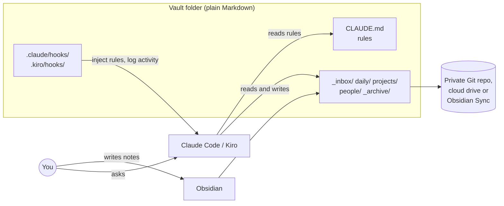
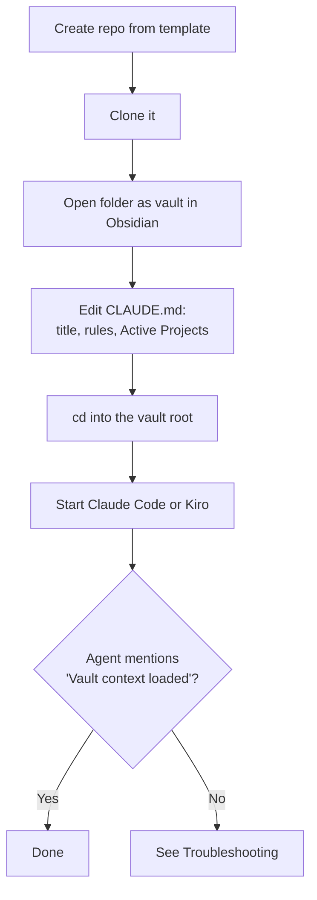
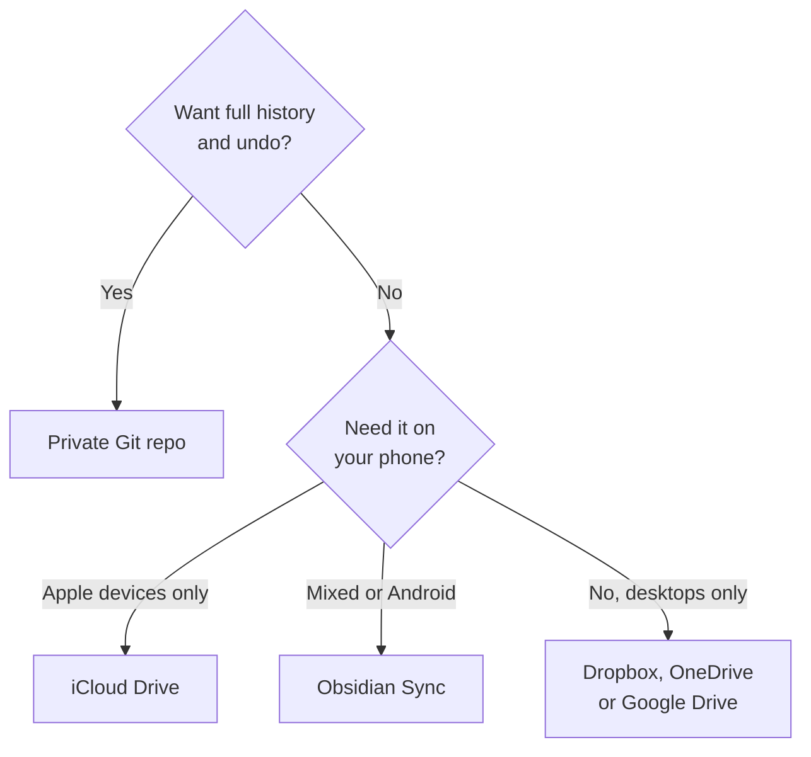
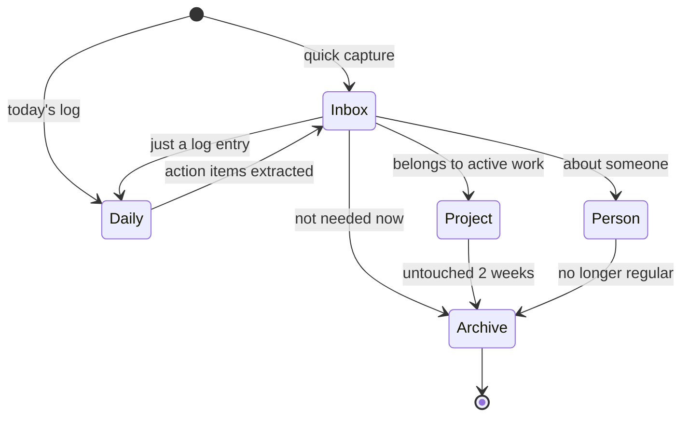
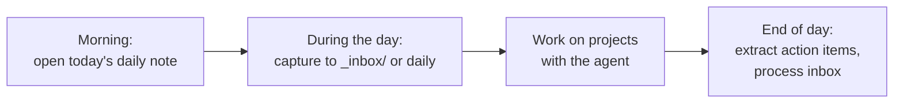
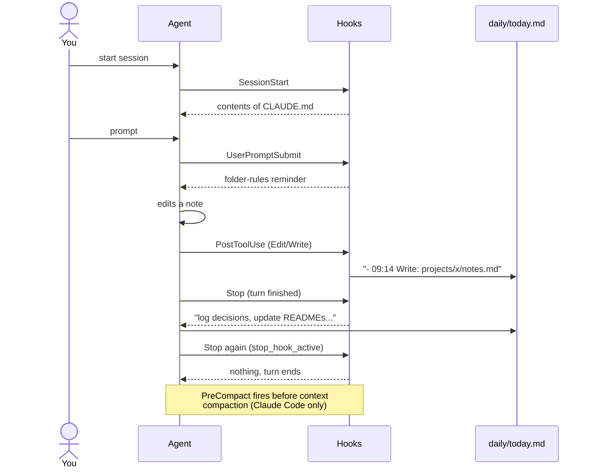
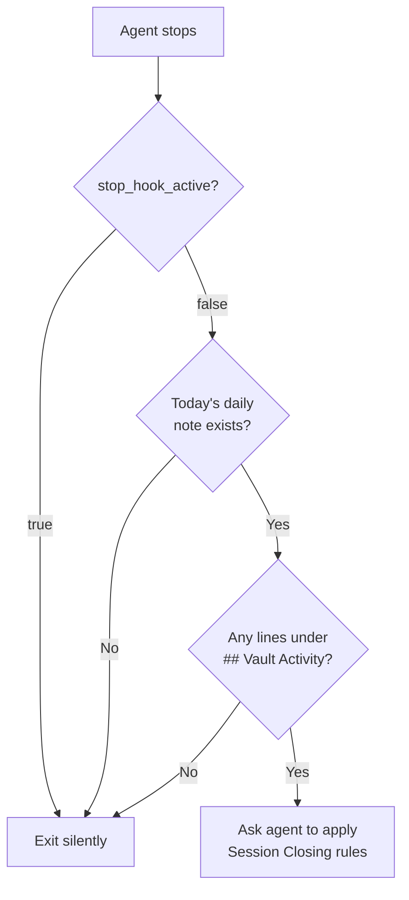
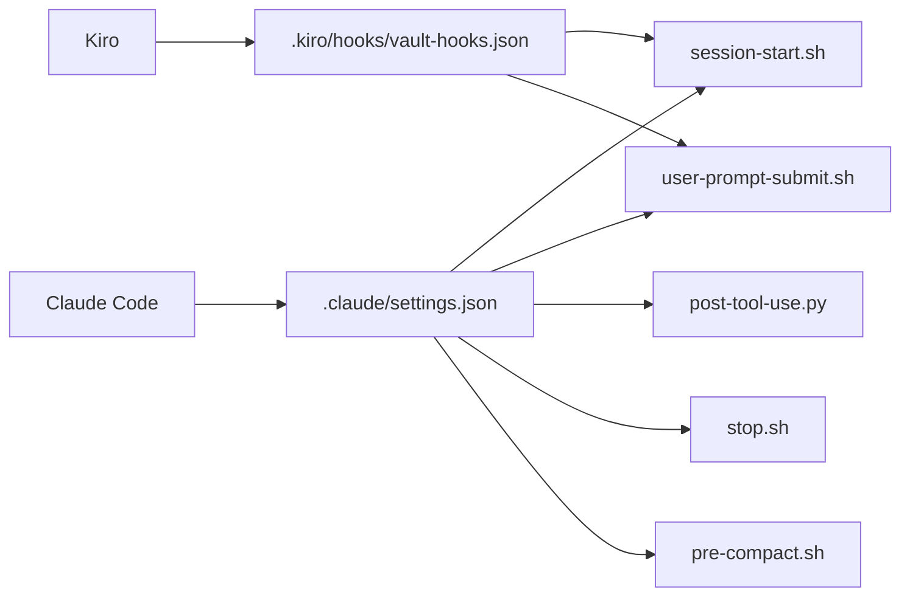

# User Guide

How to set up a vault from this template, use it day to day, and work with
Claude Code or Kiro inside it.

This guide ships in `_archive/docs/` so it stays inside the five-folder layout.
Once you're set up, keep it for reference or delete the `_archive/docs/` folder.
Delete it yourself: the agent's rules tell it never to delete notes.

- [1. How it fits together](#1-how-it-fits-together)
- [2. Setup](#2-setup)
- [3. The folders](#3-the-folders)
- [4. Daily workflow](#4-daily-workflow)
- [5. Working with the agent](#5-working-with-the-agent)
- [6. How the hooks work](#6-how-the-hooks-work)
- [7. Customizing](#7-customizing)
- [8. Troubleshooting](#8-troubleshooting)
- [9. Updating from the template](#9-updating-from-the-template)

## 1. How it fits together

The vault is a folder of plain Markdown files. Three tools work on the same
folder:

- **Obsidian** is where you read and write notes.
- **Claude Code** or **Kiro** is an assistant that files, links and summarizes
  notes.
- **Storage** of your choice backs the vault up and syncs it: a private Git
  repo, a cloud drive (iCloud, Dropbox, OneDrive, Google Drive) or Obsidian
  Sync. See [Where to store your vault](#where-to-store-your-vault).



`CLAUDE.md` tells the agent the rules: where things go, never delete, use ISO
dates and wikilinks. The hooks make sure the agent sees those rules and records
what it did.

## 2. Setup

### Prerequisites

| Tool | Needed for | Check |
|---|---|---|
| Obsidian | Editing notes | Open the app |
| Claude Code and/or Kiro | The assistant | `claude --version`, or open Kiro |
| `bash`, `jq` | Shell hooks | `jq --version` |
| `python3` | Activity-logging hook | `python3 --version` |
| `gh` (optional) | Creating the repo | `gh auth status` |

On macOS, `brew install jq gh` covers the usual gaps.

### Steps



1. **Create your vault.** Keep it private; it will hold your notes. Pick one
   of these options.

   **Option A: with `gh`.** Creates the repo and clones it in one step.

   ```bash
   gh repo create my-vault --private --template OWNER/vault-template --clone
   ```

   To install `gh`: `brew install gh` on macOS, `winget install --id GitHub.cli`
   on Windows, then `gh auth login`
   ([installation docs](https://github.com/cli/cli#installation)).

   **Option B: GitHub website and `git`.** No `gh` needed.

   1. Open the template on GitHub and click **Use this template**, then
      **Create a new repository**.
   2. Name it (for example `my-vault`), choose **Private**, and click
      **Create repository**.
   3. Clone it:

      ```bash
      git clone https://github.com/YOUR-USER/my-vault.git
      ```

   See GitHub's guide to
   [creating a repository from a template](https://docs.github.com/en/repositories/creating-and-managing-repositories/creating-a-repository-from-a-template).

   **Option C: no GitHub account.** Download the files and store the vault
   wherever you like, such as a local folder or a cloud drive.

   1. On the template's GitHub page, click **Code**, then **Download ZIP**.
   2. Unzip it, rename the folder to `my-vault`, and move it where you want
      it to live (see [Where to store your vault](#where-to-store-your-vault)).
   3. On macOS, make the hooks executable: `chmod +x .claude/hooks/*`.
   4. Optional, for history: `git init` and commit.

   Hidden folders (`.claude/`, `.kiro/`) are in the download. Your file
   browser may hide them.

2. **Open it in Obsidian.** Choose "Open folder as vault" and pick `my-vault`.
   Obsidian creates `.obsidian/` for its settings. The template's `.gitignore`
   keeps that folder out of git; remove that line if you want your Obsidian
   settings versioned.

3. **Edit `CLAUDE.md`.** Change the title and adjust the rules. Add an
   `## Active Projects` section if you want the prompt reminder to name your
   current project (see [Customizing](#7-customizing)).

4. **Start the agent from the vault root.**

   ```bash
   cd my-vault
   claude        # or start Kiro in this folder
   ```

   Hook paths such as `.claude/hooks/stop.sh` are relative to the vault root.
   Starting anywhere else breaks them.

5. **Check it works.** Ask "what are the vault rules?" The agent should
   describe the five folders. In Claude Code, `/hooks` lists the registered
   hooks.

### Where to store your vault

The vault is just a folder, so you can keep it anywhere. A private GitHub repo
is one option, not a requirement.

| Option | Good for | Watch out for |
|---|---|---|
| Private Git repo (GitHub, GitLab) | Full history, undo any change | Not automatic: you commit, push and pull |
| iCloud Drive | macOS, iPhone, iPad | Obsidian warns that iCloud Drive on Windows may duplicate or corrupt files. On iOS, the vault must sit in iCloud Drive's `Obsidian` folder |
| Dropbox | macOS and Windows | Not officially supported by Obsidian on iOS |
| OneDrive | Windows and macOS | Mark the vault "Always keep on this device"; avoid Files On-Demand |
| Google Drive | Windows, macOS, Android | Set the vault to Available offline; not officially supported on iOS |
| Obsidian Sync | All platforms, including mobile | Paid service |
| Local folder only | Single computer | No backup unless you add one |

Source: Obsidian's guide to
[syncing your notes across devices](https://obsidian.md/help/sync-notes), which
covers each option in more detail, including Syncthing.



Things to keep in mind:

- **Use one sync method per vault.** Obsidian advises against syncing the same
  vault through two services at once, such as Obsidian Sync and iCloud. That
  includes putting a Git repo inside a Dropbox or iCloud folder.
- **Keep files on the device.** Cloud drives can move files online-only to
  save space. The agent and hooks need the real files on disk.
- **Hooks run only where the agent runs.** On your phone, Obsidian edits notes
  but no hooks fire. Activity logging and end-of-session prompts happen only on
  the computer running Claude Code or Kiro.
- **Your notes are private data.** Whatever you pick, keep it private and
  don't share links to the vault folder.
- **`.gitignore` only applies to Git.** With a cloud drive, `.obsidian/`
  settings sync along with your notes.

## 3. The folders

```
my-vault/
  CLAUDE.md                rules for the agent
  _inbox/                  quick captures, process within 7 days
  daily/
    2026-11-01.md          one note per day
  projects/
    website-redesign/
      README.md            goal, status, next actions
      decisions.md         decision log
      notes.md             working notes
  people/
    jane-doe/
      profile.md           who they are, context
      open-asks.md         what you owe each other
      meetings/
        2026-10-28.md
  _archive/                dormant projects, old daily notes
    docs/
      user-guide.md        this guide (safe to delete)
```

| Folder | Put here | Rule of thumb |
|---|---|---|
| `_inbox/` | Anything you haven't classified yet | Older than 7 days is drift |
| `daily/` | Standups, meeting scraps, end-of-day dumps | Append only, one file per day |
| `projects/` | Active work | Untouched for 2 weeks: archive it |
| `people/` | One folder per regular contact | Read before a 1:1 |
| `_archive/` | Anything dormant | Archive is not delete |

### Naming and format conventions

- Filenames and folders: lowercase kebab-case, such as `jane-doe/`.
- Dates: ISO, `YYYY-MM-DD`, in filenames and text.
- Links: Obsidian wikilinks, `[[jane-doe]]`.
- Metadata: YAML frontmatter.

```markdown
---
date: 2026-11-01
tags: [project, website]
status: active
---
```

## 4. Daily workflow

### A note's life cycle

Every note starts somewhere temporary and ends up filed or archived.



### A typical day



- **Capture fast.** Don't decide where something goes while you're busy. Drop
  it in `_inbox/` or append it to today's daily note.
- **Process later.** Ask the agent to process the inbox. It proposes a
  destination for each note and moves them once you approve.
- **Review weekly.** Ask for a weekly review to catch stale inbox notes and
  dormant projects.

## 5. Working with the agent

### Common requests

| You say | The agent |
|---|---|
| "Process the inbox" | Proposes a destination for each `_inbox/` note, then moves on approval |
| "Prep me for my 1:1 with Jane" | Reads `people/jane-doe/`, summarizes recent meetings and open asks |
| "Weekly review" | Flags inbox notes older than 7 days and projects untouched for 2 weeks |
| "Log this decision: ..." | Appends to today's daily note under `## Decisions` |
| "Start a project for X" | Creates `projects/x/` with a README and decision log |

### Rules the agent follows

These come from `CLAUDE.md`:

- Never deletes notes. It moves them to `_archive/`.
- Doesn't rewrite your notes. It appends, or asks first.
- In `daily/`, only appends to today's file.
- Doesn't create new top-level folders.
- Doesn't touch `.obsidian/`.

If the agent breaks a rule, tell it. Better still, tighten the wording in
`CLAUDE.md`.

## 6. How the hooks work

A hook is a script the agent runs automatically on an event. It gets the event
as JSON on stdin and can feed text back to the agent through stdout. This
vault's hooks do two jobs: keep the rules in front of the agent, and record
what happened in your daily note.

### When each hook fires



### The hooks

| Script | Event | What it does | Claude Code | Kiro |
|---|---|---|---|---|
| `session-start.sh` | SessionStart | Prints `CLAUDE.md` into the agent's context | Yes | Yes |
| `user-prompt-submit.sh` | UserPromptSubmit | Prints the folder-rules reminder and the active project | Yes | Yes |
| `post-tool-use.py` | PostToolUse | Appends each edit to `## Vault Activity` in today's daily note | Yes | Not yet |
| `stop.sh` | Stop | If there was activity today, asks the agent to log decisions and update notes | Yes | Not yet |
| `pre-compact.sh` | PreCompact | Asks the agent to log decisions before context is compacted | Yes | No equivalent |

In Claude Code, `SessionStart` is registered for `startup` and `resume` only,
so it doesn't fire after `/clear` or compaction.

### What ends up in your daily note

```markdown
# 2026-11-01

## Vault Activity
- 09:14 Write: `projects/website-redesign/notes.md`
- 09:20 Edit: `people/jane-doe/open-asks.md`

## Decisions
- 09:25 Decision: Move launch to Q1. Reasoning: vendor delay.
```

`post-tool-use.py` writes the activity lines. The agent writes the decisions
when `stop.sh` or `pre-compact.sh` prompts it.

### How `stop.sh` decides



The `stop_hook_active` check stops the hook from firing again after the agent
has already responded to it. Without it, the agent would loop.

### Claude Code and Kiro

Both tools read the same scripts in `.claude/hooks/`. Each has its own
registration file:



`session-start.sh` and `user-prompt-submit.sh` print plain text, which both
tools add to the agent's context. The other hooks are Claude Code only for now:

- `post-tool-use.py`: Kiro's docs don't specify the fields its file-write tools
  send.
- `stop.sh`: Kiro doesn't document a `stop_hook_active` equivalent, so the loop
  guard wouldn't work.
- `pre-compact.sh`: Kiro has no pre-compaction event.

References: [Claude Code hooks](https://code.claude.com/docs/en/hooks),
[Kiro hooks](https://kiro.dev/docs/hooks/index),
[Kiro hook types](https://kiro.dev/docs/hooks/types).

## 7. Customizing

### Name your active project

`user-prompt-submit.sh` reads the first project listed under
`## Active Projects` in `CLAUDE.md`. Add a section like this:

```markdown
## Active Projects

- `projects/website-redesign/` - new marketing site
- `projects/q1-planning/` - planning doc
```

The reminder then says `Active project: website-redesign`. Only the first line
counts, so keep your current focus on top. Folder names must be lowercase
letters, digits and hyphens.

### Change the rules

Edit `CLAUDE.md`. Short, direct rules work best. The agent loads it at the
start of every session.

### Change the reminder

Edit the `REMINDER` text in `.claude/hooks/user-prompt-submit.sh`. It's
added to every prompt, so keep it short.

### Add a hook

1. Write the script in `.claude/hooks/` and make it executable
   (`chmod +x`).
2. Register it in `.claude/settings.json` for Claude Code.
3. To share it with Kiro, also register it in `.kiro/hooks/vault-hooks.json`
   and print plain text rather than Claude-specific JSON.
4. Test it by hand before relying on it:

   ```bash
   echo '{}' | .claude/hooks/your-hook.sh
   ```

### Turn a hook off

- Claude Code: remove its entry from `.claude/settings.json`.
- Kiro: add `"enabled": false` to its entry in `vault-hooks.json`.

## 8. Troubleshooting

| Symptom | Likely cause | Fix |
|---|---|---|
| Agent doesn't know the vault rules | Started outside the vault root | `cd` into the vault, restart the agent |
| `permission denied` on a hook | Script lost its executable bit | `chmod +x .claude/hooks/*` |
| `jq: command not found` | `jq` not installed | `brew install jq` |
| `Active project:` is blank | No `## Active Projects` section in `CLAUDE.md` | Add one (see Customizing) |
| Stop hook fires after every reply | Old `stop.sh` without the `stop_hook_active` check | Update `stop.sh` from the template |
| No activity lines in the daily note | `post-tool-use.py` not running, or using Kiro | Check `python3`; Kiro isn't wired for it yet |

### Test a hook by hand

Run from the vault root and feed it a fake event:

```bash
echo '{}' | .claude/hooks/session-start.sh
echo '{}' | .claude/hooks/user-prompt-submit.sh
echo '{"stop_hook_active": false}' | .claude/hooks/stop.sh
echo '{"stop_hook_active": true}' | .claude/hooks/stop.sh   # should print nothing
```

A healthy hook exits 0. Check with `echo $?` right after.

## 9. Updating from the template

A repo created from a template is a copy. It has no link back to the template
and starts from one commit ([GitHub docs](https://docs.github.com/en/repositories/creating-and-managing-repositories/creating-a-repository-from-a-template)).
Template improvements don't reach your vault automatically.

To pull in a fix, copy the changed files by hand:

```bash
# from your vault root, with the template cloned next to it
cp ../vault-template/.claude/hooks/stop.sh .claude/hooks/
git diff                    # review before committing
```

Only copy files under `.claude/`, `.kiro/` and `_archive/docs/`. Don't overwrite
`CLAUDE.md` or folder READMEs you've customized.
